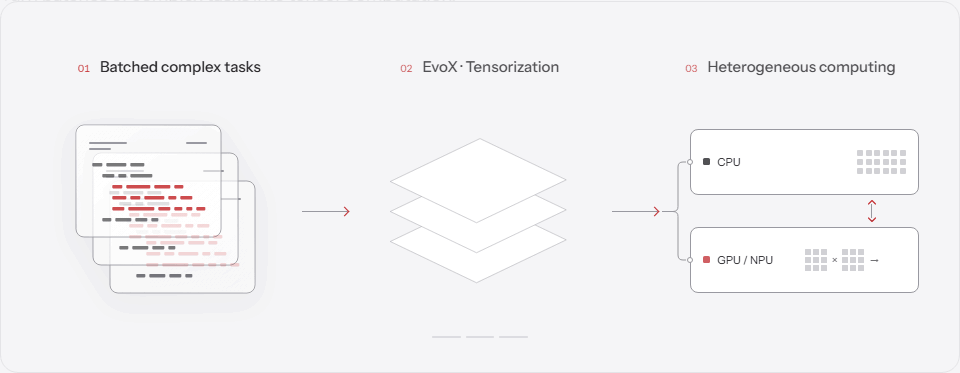
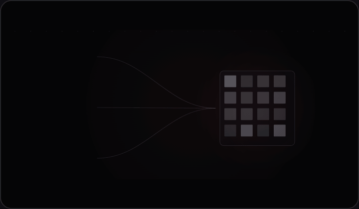
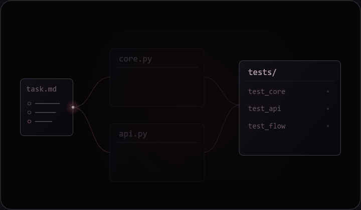
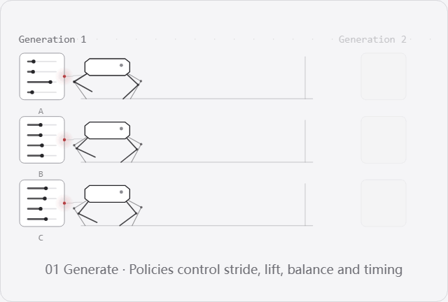
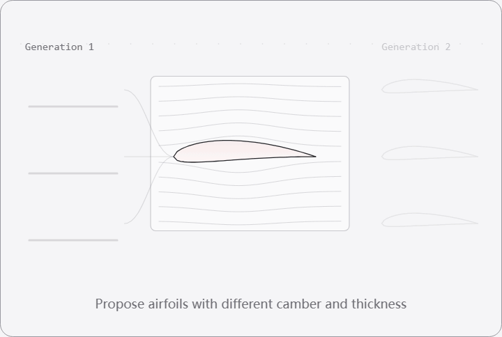

<p align="center">
  <picture>
    <source media="(prefers-color-scheme: dark)" srcset="docs/source/_static/evox_brand_light.svg">
    <source media="(prefers-color-scheme: light)" srcset="docs/source/_static/evox_brand_dark.svg">
    
  </picture>
</p>

<h1 align="center">The Infrastructure for<br>Evolutionary AI Systems</h1>

<p align="center">Enabling intelligence to adapt, create, and evolve<br>across digital and physical worlds.</p>

<p align="center">
  <a href="https://pypi.org/project/evox/"></a>
  <a href="https://pytorch.org/"></a>
  <a href="https://www.python.org/"></a>
  <a href="./LICENSE"></a>
</p>

<p align="center">
  <a href="https://www.evox.group/">Website</a> ·
  <a href="https://evox.readthedocs.io/en/latest/">Documentation</a> ·
  <a href="https://github.com/EMI-Group/evox/releases">Releases</a> ·
  <a href="./README_ZH.md">简体中文</a>
</p>

**EvoX provides the computing and experimentation foundation for AI that evolves.** Generate candidates, execute tasks, evaluate results, and build on what works. Across models, software, control policies, and scientific design, this process turns experimental feedback into continued improvement.

**Tensorization and parallel computing scale up exploration.** The PyTorch main version in this repository organizes candidates and their evaluation as batched tensor computation on CPUs and GPUs. Composable algorithms, problems, and workflows connect search, execution, and feedback.

<picture>
  <source media="(prefers-reduced-motion: reduce)" srcset="docs/source/_static/readme-compute-en.svg">
  
</picture>

[View the static diagram](docs/source/_static/readme-compute-en.svg)

## Choose your version

| | **EvoX 1.x · Main version** | **EvoX 2.0 alpha · Experimental** |
|---|---|---|
| Branch | [`main`](https://github.com/EMI-Group/evox/tree/main) | [`evoxc-exp`](https://github.com/EMI-Group/evox/tree/evoxc-exp) |
| Foundation | **PyTorch** | **[EvoX Compiler (`evoxc`)](https://github.com/EMI-Group/evoxc)** |
| Python import | `import evox` | `import evox_etl` |
| Python version | 3.10+ | 3.11+ |
| Start here for | Applications, experiments, and PyTorch integration | Exploring the new functional API and compiler backends |

**New to EvoX? [Get started with 1.x](#get-started).** The experimental version is a functional rewrite on EvoX Compiler, with a NumPy interpreter and optional IREE, XLA, and TVM backends. Both versions use the `evox` package name, so try the alpha in a separate environment using its [own installation guide](https://github.com/EMI-Group/evox/blob/evoxc-exp/README.md#installation).

The earlier JAX implementation is available at [`v0.9.0`](https://github.com/EMI-Group/evox/tree/v0.9.0).

## Part of the EvoX ecosystem

Across digital and physical worlds, the EvoX ecosystem applies evolution to model merging, software development, robot control, and scientific design.

| **Generative AI** | **Agentic AI** |
|---|---|
| <picture><source media="(prefers-reduced-motion: reduce)" srcset="docs/source/_static/readme-generative.png"></picture> | <picture><source media="(prefers-reduced-motion: reduce)" srcset="docs/source/_static/readme-agentic.png"></picture> |
| **Evolve the models.**<br>[EvoGM](https://github.com/JiangTao97/evogm) · Evolutionary model merging | **Evolve the software.**<br>[EvoX Genesis](https://github.com/EMI-Group/genesis) · Recursive agentic system |

| **Physical AI** | **AI for Science** |
|---|---|
| <picture><source media="(prefers-reduced-motion: reduce)" srcset="docs/source/_static/readme-physical.png"></picture> | <picture><source media="(prefers-reduced-motion: reduce)" srcset="docs/source/_static/readme-science.png"></picture> |
| **Evolve the behavior.**<br>[EvoRL](https://github.com/EMI-Group/evorl) · Evolutionary reinforcement learning | **Evolve the design.**<br>[EvoGO](https://github.com/EMI-Group/evogo) · Generative optimization |

Explore the [full ecosystem](https://www.evox.group/libs), or follow the experimental compiler work in [EvoX Compiler](https://github.com/EMI-Group/evoxc).

## Get started

Install [PyTorch for your hardware](https://pytorch.org/get-started/locally/), then install EvoX 1.x with visualization support:

```bash
python -m pip install "evox[default]>=1.4,<2"
```

### Run your first search

Optimize the 10-dimensional Ackley function with particle swarm optimization:

```python
import torch
from evox.algorithms import PSO
from evox.problems.numerical import Ackley
from evox.workflows import EvalMonitor, StdWorkflow

torch.set_default_device("cuda" if torch.cuda.is_available() else "cpu")
torch.manual_seed(42)

algorithm = PSO(
    pop_size=100,
    lb=-32 * torch.ones(10),
    ub=32 * torch.ones(10),
)
monitor = EvalMonitor()
workflow = StdWorkflow(algorithm, Ackley(), monitor)

workflow.init_step()
for _ in range(100):
    workflow.step()

print("Best fitness:", monitor.get_best_fitness().item())
# monitor.plot().show()  # Optional: inspect the convergence curve.
```

**Algorithm** generates and updates candidates. **Problem** evaluates a batch. **Workflow** connects them. **Monitor** records the results.

<details>
<summary><strong>Use your own objective</strong></summary>

Implement a batched evaluation function. For a single objective, map a tensor of shape `(population_size, dimensions)` to one fitness value per candidate:

```python
from evox.core import Problem

class Sphere(Problem):
    def evaluate(self, candidates: torch.Tensor) -> torch.Tensor:
        return candidates.square().sum(dim=-1)
```

Pass `Sphere()` in place of `Ackley()` when constructing the workflow. EvoX minimizes by default; use `opt_direction="max"` in `StdWorkflow` for maximization.

</details>

<details>
<summary><strong>Optimize multiple objectives</strong></summary>

The same workflow supports multi-objective search. This example uses RVEA on DTLZ2:

```python
import torch
from evox.algorithms import RVEA
from evox.problems.numerical import DTLZ2
from evox.workflows import EvalMonitor, StdWorkflow

torch.manual_seed(42)
algorithm = RVEA(
    pop_size=100,
    n_objs=2,
    lb=torch.zeros(12),
    ub=torch.ones(12),
)
monitor = EvalMonitor(multi_obj=True)
workflow = StdWorkflow(algorithm, DTLZ2(m=2), monitor)

workflow.init_step()
for _ in range(100):
    workflow.step()

print("Pareto-front fitness shape:", monitor.get_pf_fitness().shape)
# monitor.plot().show()
```

</details>

Continue with the [tutorials](https://evox.readthedocs.io/en/latest/tutorial/index.html), [neuroevolution examples](docs/source/examples/brax.ipynb), or [hyperparameter optimization](docs/source/examples/hpo.ipynb).

## Libraries, benchmarks, and tooling

Algorithm libraries propose candidates. Benchmarks and simulation environments provide evaluation feedback. Workflows organize iteration, while tensorization and compiler tools support execution at scale. Together, these components provide infrastructure for exploration and validation:

| Layer | Libraries and resources | What they provide |
|---|---|---|
| **Algorithm libraries** | [EvoX](src/evox/algorithms) · [EvoMO](https://github.com/EMI-Group/evomo) · [EvoGP](https://github.com/EMI-Group/evogp) · [TensorNEAT](https://github.com/EMI-Group/tensorneat) | Tensorized optimization, multi-objective search, genetic programming, and neural topology evolution. |
| **Benchmarks** | [EvoXBench](https://github.com/EMI-Group/evoxbench) · [MoRobtrol in EvoMO](https://github.com/EMI-Group/evomo) · [EvoX problem library](src/evox/problems) | Neural architecture search, multi-objective robot control, and numerical optimization test suites. |
| **Learning and simulation** | [EvoRL](https://github.com/EMI-Group/evorl) · [EvoX neuroevolution](src/evox/problems/neuroevolution) | Evolutionary reinforcement learning, batched policy evaluation, and integration with environments such as Brax and MuJoCo Playground. |
| **Experiment tools** | [Workflows and monitors](src/evox/workflows) · [Metrics](src/evox/metrics) · [Hyperparameter optimization](docs/source/examples/hpo.ipynb) | Compose experiments, track convergence and Pareto fronts, compare results, and tune configurations. |
| **Compilation and migration** | [EvoX Compiler](https://github.com/EMI-Group/evoxc) · [EvoCoCo](https://github.com/EMI-Group/evococo) | Compiler backends for the experimental EvoX line; automatic tensorization of MATLAB multi-objective optimization code into PyTorch/EvoX implementations. |

For neural and simulation integrations in EvoX 1.x:

```bash
python -m pip install "evox[default,neuroevolution]>=1.4,<2"
```

### Execution and hardware

The PyTorch version runs on **CPU**, **NVIDIA GPU (CUDA)**, **AMD GPU (ROCm)**, and **Apple Silicon (MPS, eager execution)** through the corresponding PyTorch backend. See the [hardware guide](docs/source/miscellaneous/other_gpus.md) for setup.

For supported compilation environments, compile the repeated step before entering the search loop:

```python
from evox import compile

workflow.step = compile(workflow.step)
```

[Multi-GPU and distributed workflows](docs/source/guide/experimental/distributed_workflow.md) are experimental and require a distributed launch and configuration. See [benchmark scripts](benchmarks) for reproducible performance experiments.

## Community and contributing

- **Questions and ideas:** [GitHub Discussions](https://github.com/EMI-Group/evox/discussions), [Discord](https://discord.gg/Vbtgcpy7G4), or [QQ group 297969717](https://qm.qq.com/q/vTPvoMUGAw).
- **Bugs and contributions:** [Open an issue](https://github.com/EMI-Group/evox/issues) or start with the [developer guide](https://evox.readthedocs.io/en/latest/guide/developer/index.html).
- **Research and collaboration:** [Ran Cheng](https://chengran.tech/).

<details>
<summary>Install the main version from source</summary>

```bash
git clone --branch main https://github.com/EMI-Group/evox.git
cd evox
python -m pip install -e ".[default]"
```

</details>

## Citation

If EvoX supports your research, please cite the [framework paper](https://arxiv.org/abs/2301.12457):

```bibtex
@article{evox,
  title = {{EvoX}: A Distributed GPU-accelerated Framework for Scalable Evolutionary Computation},
  author = {Huang, Beichen and Cheng, Ran and Li, Zhuozhao and Jin, Yaochu and Tan, Kay Chen},
  journal = {IEEE Transactions on Evolutionary Computation},
  year = {2024},
  doi = {10.1109/TEVC.2024.3388550}
}
```

## License

EvoX is licensed under [GPL-3.0-or-later](LICENSE). Related projects, including EvoX Compiler, carry their own licenses.
