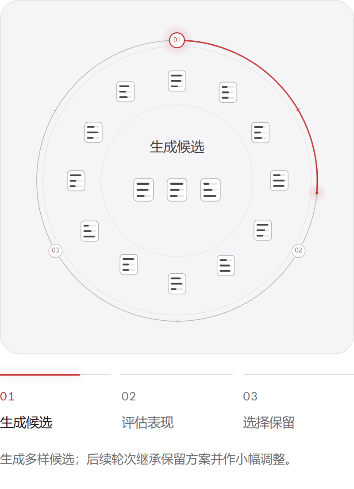
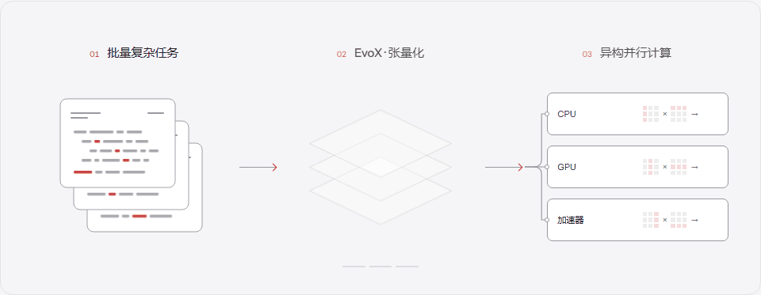
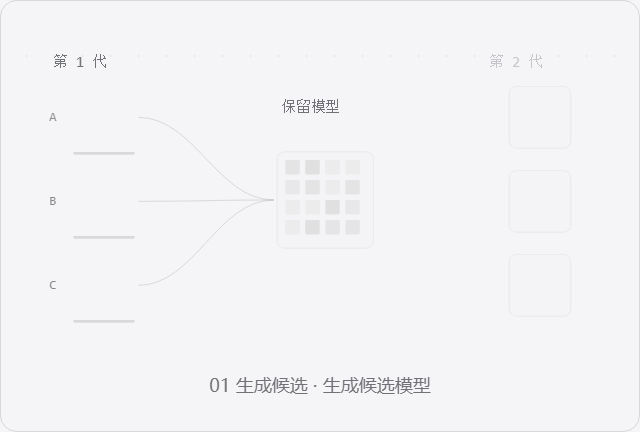
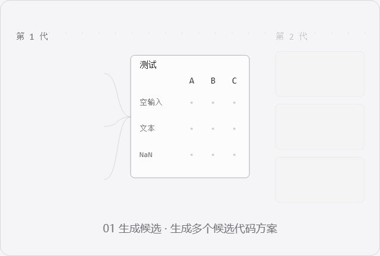
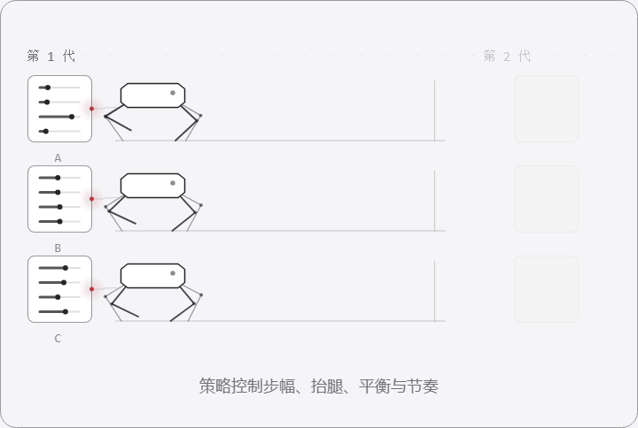
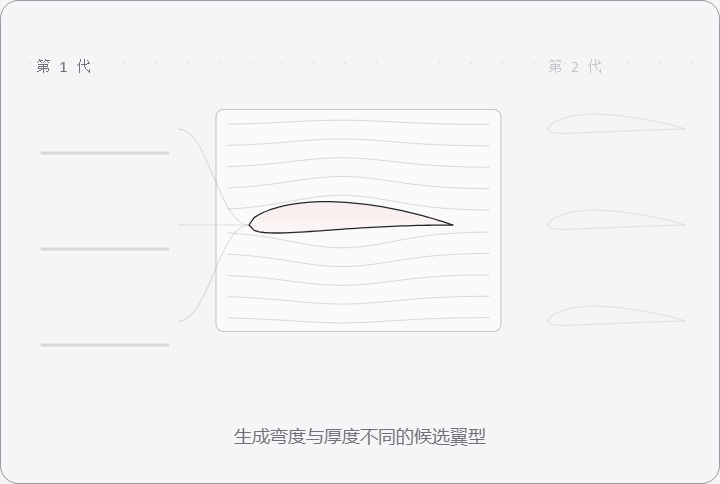

<p align="center">
  <picture>
    <source media="(prefers-color-scheme: dark)" srcset="docs/source/_static/evox_brand_light.svg">
    <source media="(prefers-color-scheme: light)" srcset="docs/source/_static/evox_brand_dark.svg">
    
  </picture>
</p>

<h1 align="center">面向演化式 AI 系统的<br>基础设施</h1>

<p align="center">让智能跨越数字与物理世界，持续适应、创造与演化。</p>

<p align="center">
  <a href="https://pypi.org/project/evox/"></a>
  <a href="https://pytorch.org/"></a>
  <a href="https://www.python.org/"></a>
  <a href="./LICENSE"></a>
</p>

<p align="center">
  <a href="https://www.evox.group/zh-cn/">官网</a> ·
  <a href="https://evox.readthedocs.io/zh-cn/latest/">文档</a> ·
  <a href="https://github.com/EMI-Group/evox/releases">版本发布</a> ·
  <a href="./README.md">English</a>
</p>

**EvoX 为持续演化的 AI 提供计算与实验基础。** 从模型、软件到控制策略与科学设计，EvoX 将种群搜索与可扩展的评估计算连接起来。

## 演化如何发生

<table>
<tr>
<td width="50%" valign="middle">
<p>演化让探索积累经验：有效的特征被保留下来，新的候选在此基础上继续变化。EvoX 为这一循环提供批量评估和并行计算，让模型、软件、控制策略与科学设计能在同一思路下持续探索。</p>
</td>
<td width="50%" valign="middle">
<picture>
  <source media="(prefers-reduced-motion: reduce)" srcset="docs/source/_static/readme-evolution-loop-zh.png">
  
</picture>
</td>
</tr>
</table>

[查看静态图](docs/source/_static/readme-evolution-loop-zh.png) · 图中为简化搜索示例；具体候选更新与选择规则因算法而异。

## 扩大搜索规模

**张量化与并行计算扩大探索规模。** 本仓库的 PyTorch 主版本将候选解及其评估组织为 CPU、GPU 上的批量张量计算，以可组合的算法、问题和工作流连接搜索、执行与反馈。

<picture>
  <source media="(prefers-reduced-motion: reduce)" srcset="docs/source/_static/readme-compute-zh.png">
  
</picture>

[查看静态图](docs/source/_static/readme-compute-zh.png) · 可用硬件取决于下方所选的版本与后端。

## 选择版本

| | **EvoX 1.x · 主版本** | **EvoX 2.0 alpha · 实验版** |
|---|---|---|
| 分支 | [`main`](https://github.com/EMI-Group/evox/tree/main) | [`evoxc-exp`](https://github.com/EMI-Group/evox/tree/evoxc-exp) |
| 计算基础 | **PyTorch** | **[EvoX Compiler（`evoxc`）](https://github.com/EMI-Group/evoxc)** |
| Python 导入 | `import evox` | `import evox_etl` |
| Python 版本 | 3.10+ | 3.11+ |
| 适合用途 | 应用开发、科研实验、PyTorch 集成 | 探索新的函数式 API 与编译后端 |

**首次使用，建议从 [1.x 快速开始](#快速开始)入手。** 实验版基于 EvoX Compiler 进行函数式重写，提供 NumPy 解释执行及可选的 IREE、XLA、TVM 后端。两个版本共用 `evox` 包名；试用 alpha 版时，请在独立环境中按照其[安装说明](https://github.com/EMI-Group/evox/blob/evoxc-exp/README.md#installation)操作。

早期 JAX 实现保留在 [`v0.9.0`](https://github.com/EMI-Group/evox/tree/v0.9.0)。

## EvoX 生态

同一演化循环在 EvoX 生态中有不同的载体：模型权重、代码、控制策略或几何形状都可以成为候选方案。以下四组动画各展示两代搜索，呈现保留特征与局部调整如何共同构成下一轮候选。

| **生成式 AI** | **智能体 AI** |
|---|---|
| <picture><source media="(prefers-reduced-motion: reduce)" srcset="docs/source/_static/readme-generative-zh.png"></picture> | <picture><source media="(prefers-reduced-motion: reduce)" srcset="docs/source/_static/readme-agentic-zh.png"></picture> |
| **演化模型。** 保留有效权重，探索小幅调整。<br>[EvoGM](https://github.com/JiangTao97/evogm) · 演化式模型融合 | **演化软件。** 用同一组测试比较代码变体。<br>[EvoX Genesis](https://github.com/EMI-Group/genesis) · 递归智能体系统 |

| **物理 AI** | **AI for Science** |
|---|---|
| <picture><source media="(prefers-reduced-motion: reduce)" srcset="docs/source/_static/readme-physical-zh.png"></picture> | <picture><source media="(prefers-reduced-motion: reduce)" srcset="docs/source/_static/readme-science-zh.png"></picture> |
| **演化行为。** 继承控制策略，调整策略参数。<br>[EvoRL](https://github.com/EMI-Group/evorl) · 演化强化学习 | **演化设计。** 继承几何形状，评估形状变化。<br>[EvoGO](https://github.com/EMI-Group/evogo) · 生成式优化 |

浏览[完整生态](https://www.evox.group/zh-cn/libs)，或了解实验版使用的 [EvoX Compiler](https://github.com/EMI-Group/evoxc)。

## 快速开始

先安装[适合硬件的 PyTorch](https://pytorch.org/get-started/locally/)，再安装包含可视化功能的 EvoX 1.x：

```bash
python -m pip install "evox[default]>=1.4,<2"
```

### 运行第一次搜索

用粒子群优化算法求解 10 维 Ackley 函数：

```python
import torch
from evox.algorithms import PSO
from evox.problems.numerical import Ackley
from evox.workflows import EvalMonitor, StdWorkflow

torch.set_default_device("cuda" if torch.cuda.is_available() else "cpu")
torch.manual_seed(42)

algorithm = PSO(
    pop_size=100,
    lb=-32 * torch.ones(10),
    ub=32 * torch.ones(10),
)
monitor = EvalMonitor()
workflow = StdWorkflow(algorithm, Ackley(), monitor)

workflow.init_step()
for _ in range(100):
    workflow.step()

print("Best fitness:", monitor.get_best_fitness().item())
# monitor.plot().show()  # Optional: inspect the convergence curve.
```

**Algorithm** 生成并更新候选解，**Problem** 批量评估，**Workflow** 组织运行，**Monitor** 记录结果。

<details>
<summary><strong>使用自己的目标函数</strong></summary>

实现一个批量评估函数。单目标问题接收形状为 `(population_size, dimensions)` 的张量，为每个候选解返回一个适应度值：

```python
from evox.core import Problem

class Sphere(Problem):
    def evaluate(self, candidates: torch.Tensor) -> torch.Tensor:
        return candidates.square().sum(dim=-1)
```

构建工作流时，将 `Ackley()` 替换为 `Sphere()` 即可。EvoX 默认最小化目标；最大化问题可在 `StdWorkflow` 中设置 `opt_direction="max"`。

</details>

<details>
<summary><strong>优化多个目标</strong></summary>

同一套工作流也支持多目标搜索。下面用 RVEA 求解 DTLZ2：

```python
import torch
from evox.algorithms import RVEA
from evox.problems.numerical import DTLZ2
from evox.workflows import EvalMonitor, StdWorkflow

torch.manual_seed(42)
algorithm = RVEA(
    pop_size=100,
    n_objs=2,
    lb=torch.zeros(12),
    ub=torch.ones(12),
)
monitor = EvalMonitor(multi_obj=True)
workflow = StdWorkflow(algorithm, DTLZ2(m=2), monitor)

workflow.init_step()
for _ in range(100):
    workflow.step()

print("Pareto-front fitness shape:", monitor.get_pf_fitness().shape)
# monitor.plot().show()
```

</details>

接下来可阅读[系列教程](https://evox.readthedocs.io/zh-cn/latest/tutorial/index.html)、[神经演化示例](docs/source/examples/brax.ipynb)或[超参数优化示例](docs/source/examples/hpo.ipynb)。

## 算法库、Benchmark 与工具链

算法库提出候选，Benchmark 与仿真环境提供评估反馈，工作流组织迭代，张量化与编译工具支撑规模化执行。这些组件共同构成从探索到验证的基础设施：

| 层次 | 算法库与资源 | 提供的能力 |
|---|---|---|
| **算法库** | [EvoX](src/evox/algorithms) · [EvoMO](https://github.com/EMI-Group/evomo) · [EvoGP](https://github.com/EMI-Group/evogp) · [TensorNEAT](https://github.com/EMI-Group/tensorneat) | 张量化优化、多目标搜索、遗传编程与神经网络拓扑演化。 |
| **Benchmark** | [EvoXBench](https://github.com/EMI-Group/evoxbench) · [EvoMO / MoRobtrol](https://github.com/EMI-Group/evomo) · [EvoX 问题库](src/evox/problems) | 神经架构搜索、多目标机器人控制与数值优化测试套件。 |
| **学习与仿真** | [EvoRL](https://github.com/EMI-Group/evorl) · [EvoX 神经演化](src/evox/problems/neuroevolution) | 演化强化学习、批量策略评估，以及 Brax、MuJoCo Playground 等环境集成。 |
| **实验工具** | [工作流与监测器](src/evox/workflows) · [评价指标](src/evox/metrics) · [超参数优化](docs/source/examples/hpo.ipynb) | 组合实验流程，跟踪收敛与 Pareto 前沿，对比结果并优化配置。 |
| **编译与迁移** | [EvoX Compiler](https://github.com/EMI-Group/evoxc) · [EvoCoCo](https://github.com/EMI-Group/evococo) | 实验版 EvoX 的编译后端；将 MATLAB 多目标优化代码自动张量化为 PyTorch/EvoX 实现。 |

如需使用 EvoX 1.x 的神经演化与仿真集成：

```bash
python -m pip install "evox[default,neuroevolution]>=1.4,<2"
```

### 执行与硬件

PyTorch 版本通过对应后端运行于 **CPU**、**NVIDIA GPU（CUDA）**、**AMD GPU（ROCm）**及 **Apple Silicon（MPS，eager 执行）**。配置方式见[硬件指南](docs/source/miscellaneous/other_gpus.md)。

在支持编译的环境中，可在进入搜索循环前编译反复执行的步骤：

```python
from evox import compile

workflow.step = compile(workflow.step)
```

[多 GPU 与分布式工作流](docs/source/guide/experimental/distributed_workflow.md)目前为实验功能，需要配置分布式环境并使用相应方式启动。可复现的性能实验见[基准测试脚本](benchmarks)。

## 社区与贡献

- **提问与讨论：** [GitHub Discussions](https://github.com/EMI-Group/evox/discussions)、[Discord](https://discord.gg/Vbtgcpy7G4) 或 [QQ 群 297969717](https://qm.qq.com/q/vTPvoMUGAw)。
- **问题反馈与代码贡献：** [提交 Issue](https://github.com/EMI-Group/evox/issues)，或从[开发者指南](https://evox.readthedocs.io/zh-cn/latest/guide/developer/index.html)开始。
- **研究合作：** [程然主页](https://chengran.tech/)。

<details>
<summary>从源码安装主版本</summary>

```bash
git clone --branch main https://github.com/EMI-Group/evox.git
cd evox
python -m pip install -e ".[default]"
```

</details>

## 引用

如果 EvoX 对你的研究有帮助，请引用[框架论文](https://arxiv.org/abs/2301.12457)：

```bibtex
@article{evox,
  title = {{EvoX}: A Distributed GPU-accelerated Framework for Scalable Evolutionary Computation},
  author = {Huang, Beichen and Cheng, Ran and Li, Zhuozhao and Jin, Yaochu and Tan, Kay Chen},
  journal = {IEEE Transactions on Evolutionary Computation},
  year = {2024},
  doi = {10.1109/TEVC.2024.3388550}
}
```

## 许可证

EvoX 使用 [GPL-3.0-or-later](LICENSE) 许可证。EvoX Compiler 等相关项目采用各自的许可证。
