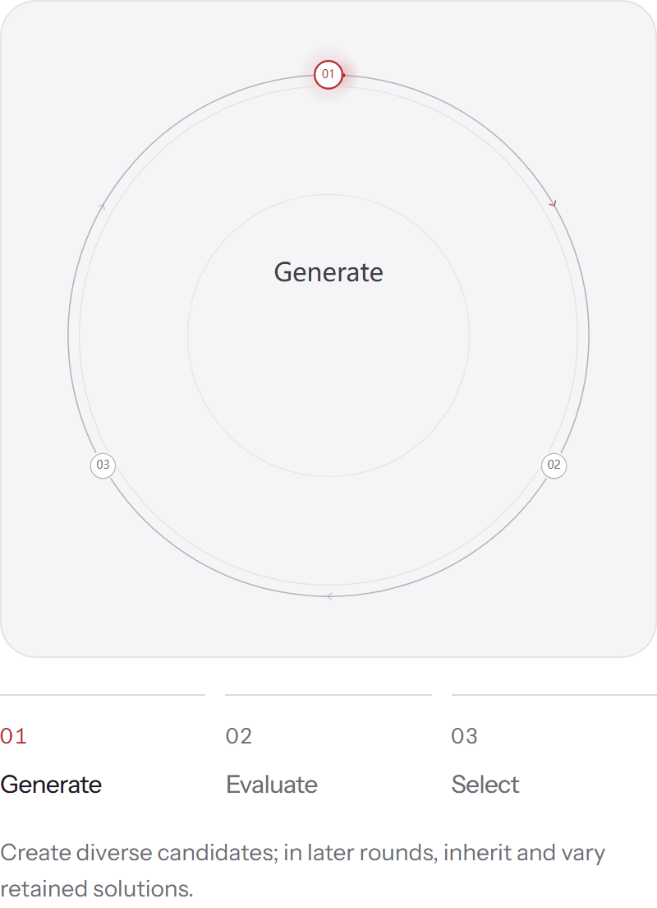
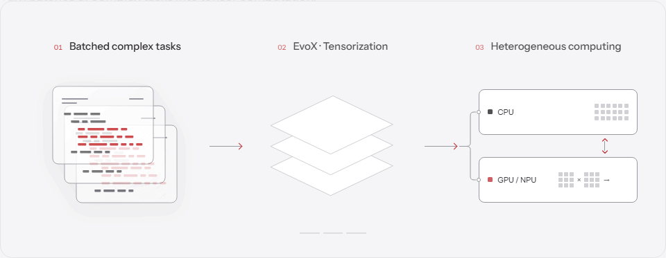
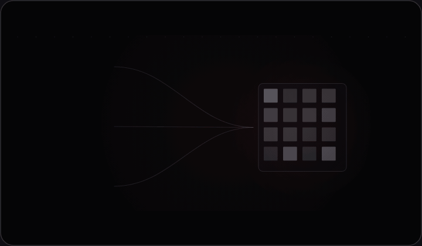
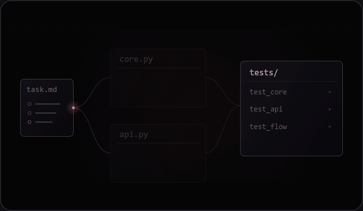
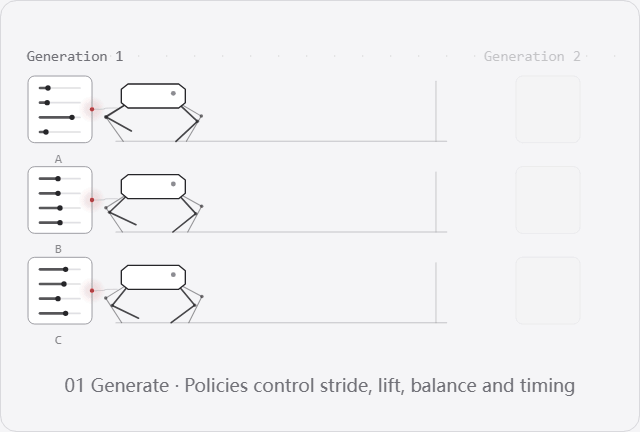
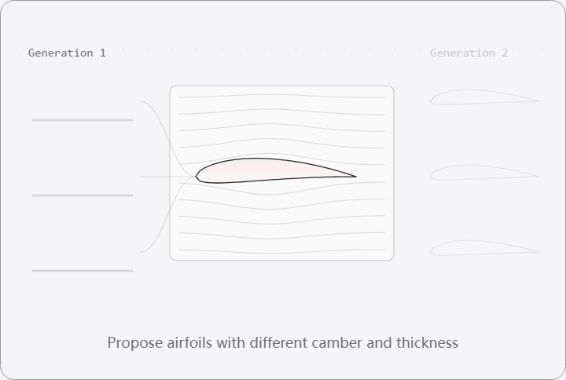

<p align="center">
  <picture>
    <source media="(prefers-color-scheme: dark)" srcset="docs/source/_static/evox_brand_light.svg">
    <source media="(prefers-color-scheme: light)" srcset="docs/source/_static/evox_brand_dark.svg">
    
  </picture>
</p>

<h1 align="center">演化式 AI 系統的<br>基礎設施</h1>

<p align="center">讓智能跨越數碼與實體世界，<br>持續適應、創造與演化。</p>

<p align="center">
  <a href="https://pypi.org/project/evox/"></a>
  <a href="https://pytorch.org/"></a>
  <a href="https://www.python.org/"></a>
  <a href="./LICENSE"></a>
</p>

<p align="center">
  <a href="https://www.evox.group/">官方網站</a> ·
  <a href="https://evox.readthedocs.io/en/latest/">文件</a> ·
  <a href="https://github.com/EMI-Group/evox/releases">版本發布</a> ·
  <a href="./README.md">English</a> ·
  <a href="./README_ZH.md">简体中文</a> ·
  <a href="./README_ZH_TW.md">繁體中文（TW）</a>
</p>

**EvoX 為持續演化的 AI 提供運算與實驗基礎。** 從模型、軟件、控制策略到科學設計，EvoX 將種群搜尋與可擴展的評估運算連接起來。

## 演化如何運作

**產生候選解、評估表現，並保留有效的解。** 選出的解將有用的特徵傳給下一代，再透過局部變異產生新的候選解。EvoX 透過批次評估與並行運算，擴大這個循環的規模。

<p align="center">
<picture>
  <source media="(prefers-reduced-motion: reduce)" srcset="docs/source/_static/readme-evolution-loop-en.png">
  
</picture>
</p>

[開啟完整動畫](docs/source/_static/readme-evolution-loop-en.gif) · [靜態圖](docs/source/_static/readme-evolution-loop-en.png)

## 擴大搜尋規模

**張量化與並行運算擴大探索規模。** 本儲存庫的 PyTorch 主版本將候選解及其評估組織為 CPU、GPU 上的批次張量運算。可組合的算法、問題與工作流程連接搜尋、執行與回饋。

<picture>
  <source media="(prefers-reduced-motion: reduce)" srcset="docs/source/_static/readme-compute-en.png">
  
</picture>

[開啟完整動畫](docs/source/_static/readme-compute-en.gif) · [靜態圖](docs/source/_static/readme-compute-en.png)

## 選擇版本

### EvoX 1.x · 主版本

- **分支：** [`main`](https://github.com/EMI-Group/evox/tree/main)
- **運算基礎：** **PyTorch**
- **Python 匯入：** `import evox`
- **Python 版本：** 3.10+
- **適用情境：** 應用開發、實驗與 PyTorch 整合

### EvoX 2.0 alpha · 實驗版

- **分支：** [`evoxc-exp`](https://github.com/EMI-Group/evox/tree/evoxc-exp)
- **運算基礎：** **[EvoX Compiler (`evoxc`)](https://github.com/EMI-Group/evoxc)**
- **Python 匯入：** `import evox_etl`
- **Python 版本：** 3.11+
- **適用情境：** 探索新的函數式 API 與編譯器後端

**第一次使用 EvoX？請從 [1.x 快速入門](#快速入門)開始。** 實驗版以 EvoX Compiler 為基礎，採用函數式設計重新實作，提供 NumPy 解譯器，以及可選用的 IREE、XLA、TVM 後端。兩個版本共用 `evox` 套件名稱，因此試用 alpha 版時，請在獨立環境中依照其[安裝指南](https://github.com/EMI-Group/evox/blob/evoxc-exp/README.md#installation)操作。

早期的 JAX 實作保留於 [`v0.9.0`](https://github.com/EMI-Group/evox/tree/v0.9.0)。

## EvoX 生態系統

演化在 EvoX 生態系統中有不同的形式。模型權重、控制策略與幾何形狀透過評估、選擇與遺傳變異持續演化。遞歸智能體將軟件任務拆解，在各自的分支上工作，再將成果合併至共用的程式碼庫。以下動畫分別展示兩代搜尋或兩輪智能體協作。

### 基礎模型

**讓模型演化。** EvoGM 搜尋已微調專家模型的更佳組合，無須進一步微調。動畫示範如何評估候選權重、保留最佳模型，再調整少量繼承的權重。

[EvoGM](https://github.com/JiangTao97/evogm) · 演化式模型合併

<p align="center">
<picture><source media="(prefers-reduced-motion: reduce)" srcset="docs/source/_static/readme-generative.png"></picture>
</p>

[開啟完整動畫](docs/source/_static/readme-generative.gif) · [靜態圖](docs/source/_static/readme-generative.png)

### 智能體 AI

**讓軟件演化。** 根智能體將子任務交給子智能體，子智能體也能繼續委派任務。父智能體同樣參與工作，並在所有子智能體完成後合併獲接納的提交；根智能體的合併結果最終進入 `main`。被拒的分支仍會顯示，但不會合併。

[EvoX Genesis](https://github.com/EMI-Group/genesis) · 遞歸智能體系統

<p align="center">
<picture><source media="(prefers-reduced-motion: reduce)" srcset="docs/source/_static/readme-agentic.png"></picture>
</p>

[開啟完整動畫](docs/source/_static/readme-agentic.gif) · [靜態圖](docs/source/_static/readme-agentic.png)

### 實體 AI

**讓行為演化。** 繼承控制策略，並調整其參數。

[EvoRL](https://github.com/EMI-Group/evorl) · 演化式強化學習

<p align="center">
<picture><source media="(prefers-reduced-motion: reduce)" srcset="docs/source/_static/readme-physical.png"></picture>
</p>

[開啟完整動畫](docs/source/_static/readme-physical.gif) · [靜態圖](docs/source/_static/readme-physical.png)

### 科學研究 AI

**讓設計演化。** 繼承幾何形狀，並評估形狀變化。

[EvoGO](https://github.com/EMI-Group/evogo) · 超臨界翼型設計

<p align="center">
<picture><source media="(prefers-reduced-motion: reduce)" srcset="docs/source/_static/readme-science.png"></picture>
</p>

[開啟完整動畫](docs/source/_static/readme-science.gif) · [靜態圖](docs/source/_static/readme-science.png)

探索[完整生態系統](https://www.evox.group/libs)，或關注 [EvoX Compiler](https://github.com/EMI-Group/evoxc) 的實驗性編譯器開發。

## 快速入門

先安裝[適用於您硬件的 PyTorch](https://pytorch.org/get-started/locally/)，再安裝支援可視化的 EvoX 1.x：

```bash
python -m pip install "evox[default]>=1.4,<2"
```

### 執行第一次搜尋

使用粒子群優化求解 10 維 Ackley 函數：

```python
import torch
from evox.algorithms import PSO
from evox.problems.numerical import Ackley
from evox.workflows import EvalMonitor, StdWorkflow

torch.set_default_device("cuda" if torch.cuda.is_available() else "cpu")
torch.manual_seed(42)

algorithm = PSO(
    pop_size=100,
    lb=-32 * torch.ones(10),
    ub=32 * torch.ones(10),
)
monitor = EvalMonitor()
workflow = StdWorkflow(algorithm, Ackley(), monitor)

workflow.init_step()
for _ in range(100):
    workflow.step()

print("Best fitness:", monitor.get_best_fitness().item())
# monitor.plot().show()  # Optional: inspect the convergence curve.
```

**Algorithm（算法）** 產生並更新候選解。**Problem（問題）** 評估一批候選解。**Workflow（工作流程）** 連接兩者。**Monitor（監察器）** 記錄結果。

<details>
<summary><strong>使用自己的目標函數</strong></summary>

實作批次評估函數。若只有單一目標，將形狀為 `(population_size, dimensions)` 的張量轉為每個候選解各一個適應值：

```python
from evox.core import Problem

class Sphere(Problem):
    def evaluate(self, candidates: torch.Tensor) -> torch.Tensor:
        return candidates.square().sum(dim=-1)
```

建立工作流程時，以 `Sphere()` 取代 `Ackley()`。EvoX 預設進行最小化；若要最大化，請在 `StdWorkflow` 中設定 `opt_direction="max"`。

</details>

<details>
<summary><strong>多目標優化</strong></summary>

相同的工作流程也支援多目標搜尋。以下範例以 RVEA 求解 DTLZ2：

```python
import torch
from evox.algorithms import RVEA
from evox.problems.numerical import DTLZ2
from evox.workflows import EvalMonitor, StdWorkflow

torch.manual_seed(42)
algorithm = RVEA(
    pop_size=100,
    n_objs=2,
    lb=torch.zeros(12),
    ub=torch.ones(12),
)
monitor = EvalMonitor(multi_obj=True)
workflow = StdWorkflow(algorithm, DTLZ2(m=2), monitor)

workflow.init_step()
for _ in range(100):
    workflow.step()

print("Pareto-front fitness shape:", monitor.get_pf_fitness().shape)
# monitor.plot().show()
```

</details>

接著可參考[教學](https://evox.readthedocs.io/en/latest/tutorial/index.html)、[神經演化範例](docs/source/examples/brax.ipynb)或[超參數優化](docs/source/examples/hpo.ipynb)。

## 程式庫、基準測試與工具

算法程式庫提出候選解，基準測試與模擬環境提供評估回饋。工作流程組織迭代過程，張量化與編譯器工具則支援大規模執行。這些組件共同構成探索與驗證的基礎設施：

### 算法程式庫

張量化優化、多目標搜尋、遺傳程式設計與神經網絡拓撲演化。

[EvoX](src/evox/algorithms) · [EvoMO](https://github.com/EMI-Group/evomo) · [EvoGP](https://github.com/EMI-Group/evogp) · [TensorNEAT](https://github.com/EMI-Group/tensorneat)

### 基準測試

神經架構搜尋、多目標機械人控制與數值優化測試套件。

[EvoXBench](https://github.com/EMI-Group/evoxbench) · [EvoMO 中的 MoRobtrol](https://github.com/EMI-Group/evomo) · [EvoX 問題程式庫](src/evox/problems)

### 學習與模擬

演化式強化學習、批次策略評估，以及與 Brax、MuJoCo Playground 等環境的整合。

[EvoRL](https://github.com/EMI-Group/evorl) · [EvoX 神經演化](src/evox/problems/neuroevolution)

### 實驗工具

組合實驗、追蹤收斂情形與 Pareto 前緣、比較結果，並調整設定。

[工作流程與監察器](src/evox/workflows) · [評估指標](src/evox/metrics) · [超參數優化](docs/source/examples/hpo.ipynb)

### 編譯與遷移

提供 EvoX 實驗版的編譯器後端；將 MATLAB 多目標優化程式碼自動張量化，轉為 PyTorch/EvoX 實作。

[EvoX Compiler](https://github.com/EMI-Group/evoxc) · [EvoCoCo](https://github.com/EMI-Group/evococo)

若要在 EvoX 1.x 中使用神經網絡與模擬環境整合功能：

```bash
python -m pip install "evox[default,neuroevolution]>=1.4,<2"
```

### 執行與硬件

PyTorch 版本透過對應的 PyTorch 後端，可在 **CPU**、**NVIDIA GPU（CUDA）**、**AMD GPU（ROCm）** 與 **Apple Silicon（MPS，即時執行）** 上執行。設定方式請參閱[硬件指南](docs/source/miscellaneous/other_gpus.md)。

在支援編譯的環境中，請於進入搜尋迴圈前，編譯會重複執行的步驟：

```python
from evox import compile

workflow.step = compile(workflow.step)
```

[多 GPU 與分散式工作流程](docs/source/guide/experimental/distributed_workflow.md)屬於實驗功能，需要分散式啟動與設定。若要進行可重現的效能實驗，請參閱[基準測試腳本](benchmarks)。

## 社群與貢獻

- **問題與想法：** [GitHub Discussions](https://github.com/EMI-Group/evox/discussions)、[Discord](https://discord.gg/Vbtgcpy7G4) 或 [QQ 群組 297969717](https://qm.qq.com/q/vTPvoMUGAw)。
- **錯誤回報與貢獻：** [建立 issue](https://github.com/EMI-Group/evox/issues)，或先閱讀[開發者指南](https://evox.readthedocs.io/en/latest/guide/developer/index.html)。
- **研究與合作：** [Ran Cheng](https://chengran.tech/)。

<details>
<summary>從原始碼安裝主版本</summary>

```bash
git clone --branch main https://github.com/EMI-Group/evox.git
cd evox
python -m pip install -e ".[default]"
```

</details>

## 引用

若 EvoX 對您的研究有所幫助，請引用[框架論文](https://arxiv.org/abs/2301.12457)：

```bibtex
@article{evox,
  title = {{EvoX}: A Distributed GPU-accelerated Framework for Scalable Evolutionary Computation},
  author = {Huang, Beichen and Cheng, Ran and Li, Zhuozhao and Jin, Yaochu and Tan, Kay Chen},
  journal = {IEEE Transactions on Evolutionary Computation},
  year = {2024},
  doi = {10.1109/TEVC.2024.3388550}
}
```

## 授權條款

EvoX 採用 [GPL-3.0-or-later](LICENSE) 授權。
